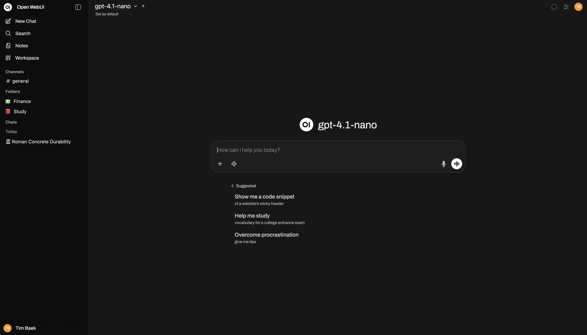

# 🦅 Lahuta

<p align="center">
  <strong>Ndërfaqe e Avancuar dhe Gjithëpërfshirëse e Inteligjencës Artificiale në Gjuhën Shqipe</strong>
</p>

<p align="center">
  
</p>

---

**Lahuta** është një platformë e inteligjencës artificiale (AI) e vetë-strehuar (*self-hosted*), e pasur me veçori, e fuqishme dhe e krijuar me fokus të veçantë në **gjuhën shqipe**. Ajo mbështet modele të ndryshme gjuhësore (LLM) duke përfshirë **Ollama**, **OpenAI**, **Anthropic Claude**, **Google Gemini** dhe çdo API të përputhshme me formatin e OpenAI.

Me motor të integruar për **RAG (Retrieval Augmented Generation)**, kërkim në ueb, biseda me zë dhe video, si dhe ekzekutim të funksioneve Python, **Lahuta** ofron një përvojë të plotë dhe të sigurt për përdoruesit individualë dhe organizatat.

<p align="center">
  
</p>

---

## ✨ Veçoritë Kryesore të Lahuta

- 🇦🇱 **Lokalizim 100% në Gjuhën Shqipe**: E gjithë ndërfaqja, menytë, njoftimet dhe cilësimet janë të parazgjedhura në shqip (`sq-AL`), me përshtatje gjuhësore me cilësi të lartë.
- 🚀 **Instalim i Thjeshtë me Docker**: Nisje e pavarur përmes Docker Compose vetëm për Lahutën (pa pasur nevojë të shkarkoni Ollama lokalisht, me mbështetje për servera të jashtëm Ollama).
- 🤝 **Integrim i Gjithanshëm me Modelet LLM**: Lidhuni lehtësisht me serverin tuaj të **Ollama** në cilindo server tjetër në rrjet, ose integroni shërbime si **OpenAI**, **Anthropic**, **Gemini**, **Groq**, **Mistral**, **OpenRouter**, **LMStudio** dhe të tjera.
- 📚 **RAG Lokal i Avancuar**: Ngarkoni dokumente (PDF, Word, Excel, tekst) drejtpërdrejt në bisedë me komandën `#`. Mbështet 9 baza të dhënash vektoriale (ChromaDB, PGVector, Qdrant, Milvus, Elasticsearch, etj.).
- 🔍 **Kërkim në Ueb për RAG**: Merrni të dhëna në kohë reale nga interneti duke përdorur SearXNG, Google PSE, Brave Search, DuckDuckGo, Tavily dhe ofrues të tjerë.
- 🌐 **Shfletim Uebi në Bisedë**: Përfshini përmbajtje nga faqet e internetit direkt në diskutim duke vendosur `#` e ndjekur nga një lidhje uebi (URL).
- 🎨 **Gjenerim & Redaktim Imazhesh**: Krijoni imazhe me DALL-E, Google Imagen, ComfyUI ose Stable Diffusion (AUTOMATIC1111).
- 🎤📹 **Biseda me Zë dhe Video (Hands-Free)**: Komunikoni me zë në kohë reale me anë të njohjes së zërit (Whisper lokal, OpenAI) dhe sintezës së zërit (TTS).
- 🐍 **Mjete & Funksione Python**: Shtoni logjikë të personalizuar përmes editorit të kodit Python të integruar (BYOF - Bring Your Own Function).
- 🛡️ **Kontroll i Qasjes me Role (RBAC)**: Menaxhoni lejet, rolet dhe grupet e përdoruesve në mënyrë të detajuar për mjedise arsimore dhe korporative.
- 📱 **Dizajn i Përshtatshëm (Responsive) & PWA**: Funksionon shkëlqyeshëm në desktop, tablet dhe celularë (si Progressive Web App).
- 🔐 **Siguri & Privatësi**: Të gjitha të dhënat mbeten nën kontrollin tuaj lokal; asnjë mesazh apo dokument nuk ndahet pa miratimin tuaj.

---

## 🚀 Si të Instaloni Lahuta

### Opsioni 1: Me Docker Compose (E Rekomanduar)

Kontejneri ngre vetëm shërbimin e **Lahutës** pa shkarkuar Ollama, pasi mund ta thërrisni Ollama nga një server tjetër:

```bash
# 1. Shkarkoni ose shkoni te dosja e Lahutës
cd Lahuta

# 2. (Opsionale) Nëse Ollama ndodhet në një server tjetër, vendosni adresën e tij:
export OLLAMA_BASE_URL="http://IP_E_SERVERIT_TUAJ:11434"

# 3. Nisni kontejnerin
docker compose up -d --build
```

Pasi shërbimi të ngrihet, hapni shfletuesin tuaj në:
👉 **[http://localhost:3000](http://localhost:3000)**

### Opsioni 2: Me Docker CLI

```bash
docker run -d -p 3000:8080 \
  -e OLLAMA_BASE_URL="http://IP_E_SERVERIT_TUAJ:11434" \
  --add-host=host.docker.internal:host-gateway \
  -v lahuta-data:/app/backend/data \
  --name lahuta \
  --restart always \
  sghtf/lahuta-ui
```

### Opsioni 3: Zhvillim Lokal (Development)

#### Kërkesat Paraprake:
- **Node.js** >= 18.13.0
- **Python** 3.11 ose 3.12

#### 1. Nisja e Backend-it:
```bash
cd backend
python -m venv venv
# Në Windows:
.\venv\Scripts\activate
# Në Linux/macOS:
source venv/bin/activate

pip install -r requirements.txt
python -m open_webui.main
```

#### 2. Nisja e Frontend-it:
```bash
npm install
npm run dev
```

Ndërfaqja do të jetë e disponueshme në: **http://localhost:5173**

---

## ⚙️ Variablat Kryesore të Mjedisit

| Variabla | Përshkrimi | Vlera e Parazgjedhur |
| :--- | :--- | :--- |
| `WEBUI_NAME` | Emri i aplikacionit në ndërfaqe | `"Lahuta"` |
| `DEFAULT_LOCALE` | Gjuha kryesore e ndërfaqes | `"sq-AL"` (Shqip) |
| `OLLAMA_BASE_URL` | URL-ja e serverit Ollama (mund të jetë server i jashtëm) | `http://host.docker.internal:11434` |
| `OPENAI_API_BASE_URL` | URL-ja e pikës fundore të OpenAI | `https://api.openai.com/v1` |
| `OPENAI_API_KEY` | Çelësi i API-së së OpenAI | Bosh |
| `WEBUI_SECRET_KEY` | Çelësi i sigurisë për sesionet | Gjenerohet automatikisht |

---

## 🇦🇱 Ekipi dhe Kontributet

**Lahuta** është ndërtuar për komunitetin shqipfolës me synimin për të sjellë mjetet më të avancuara të inteligjencës artificiale në mënyrë të thjeshtë, të sigurt dhe të plotë në gjuhën shqipe.

---

## 📜 Licenca dhe Bërthama

Ky projekt përdor si bërthamë teknologjike Open WebUI dhe zhvillohet si sistem i pavarur i lokalizuar dhe i përshtatur për Lahutën. Licencohet sipas kushteve të përcaktuara në skedarin [LICENSE](./LICENSE).
